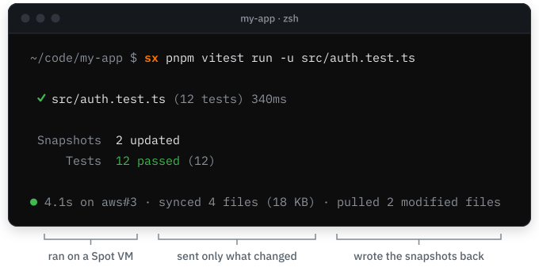

<p align="center">
  <picture>
    <source media="(prefers-color-scheme: dark)" srcset="docs/assets/readme/logo-dark.svg">
    <source media="(prefers-color-scheme: light)" srcset="docs/assets/readme/logo-light.svg">
    
  </picture>
</p>

<h1 align="center">Run your tests and builds off your&nbsp;laptop</h1>

<p align="center">
  Coding agents in parallel worktrees run test suites, type checks and builds all at once, and your laptop pays for it. Put <code>sx</code> in front of those commands and they run on a homelab box over SSH, or on a few AWS Spot VMs that every command shares and that shut down when idle. Output and exit codes stream back, and changed files return through a 3-way check that keeps any edits you made meanwhile.
</p>

<p align="center">
  <a href="https://github.com/daintreehq/spotexec/releases/latest"></a>
  
  <a href="LICENSE"></a>
</p>

<p align="center">
  <a href="#install"><b>Install</b></a> &nbsp;·&nbsp;
  <a href="#documentation">Documentation</a> &nbsp;·&nbsp;
  <a href="https://spotexec.com">spotexec.com</a>
</p>

<p align="center">
<picture>
  <source media="(prefers-color-scheme: dark)" srcset="docs/assets/readme/terminal-dark.svg">
  <source media="(prefers-color-scheme: light)" srcset="docs/assets/readme/terminal-light.svg">
  
</picture>
</p>

<p align="center">
  <code>sx</code> works with any command, as in <code>sx&nbsp;cargo&nbsp;build</code>, and runs your project's tasks by name: <code>sx&nbsp;test</code>.
</p>

## Why spotexec

When several coding agents work at once, one per git worktree, each checks its work with the test suite, the type checker, the linter and a build, all on the laptop you are typing on. Every check slows down, and the agents end up waiting on each other for CPU.

The usual ways out each cost something. **CI** is minutes away from the edit. A **cloud dev environment** moves your editor, checkout and agents off your machine. A **shared build box** needs someone to keep it running and in sync.

spotexec keeps everything local except the work. Only the heavy commands move, and only while they run, on a small pool of VMs that stay warm between commands. On [Daintree](docs/case-study-daintree.md), an Electron app with 114,000 unit tests, the full suite runs as one job on a warm Spot VM instead of locking the laptop up for 15 to 20 minutes, and every agent's checks share the same handful of VMs. [When to use spotexec](docs/when-to-use.md) covers where it helps, where it doesn't, and what it costs.

- **Your command, unchanged.** Output streams back as it runs, the exit code is the command's own, and remote paths in stack traces are rewritten to local ones.
- **Only what changed travels.** Each run sends just the files the runner is missing. Dependencies restore from a cache keyed by your lockfiles.
- **Your edits come first.** Changed files come back through a 3-way check. If you edited a file during the run, your version stays and the runner's is [saved separately](docs/running.md#write-back-and-artifacts).
- **A few warm VMs, shared.** Every command from every worktree goes to the same small pool, a couple of jobs to a VM. `max_instances` is a ceiling: past it, work queues for a warm VM instead of starting another, since each extra VM costs a cold start and then bills its idle timeout after its last job. VMs launch on the cheapest instance type and zone available at the time, power themselves off when idle, and a run that loses its VM to an interruption is replayed once.
- **Jobs stay out of each other's way.** Each job sees only its slot's CPUs, so test runners size themselves correctly, and a job that runs out of memory is killed and reported on its own, without taking down the VM or the jobs beside it.
- **Nothing to host.** No control plane, no service in your account, and no AWS credentials on the VMs. Coordination lives on your machine and in EC2 tags.
- **Made for agents.** Worktrees share one pool through isolated slots and a fair queue. Agents see one summary line, or NDJSON events with `--json`.

## Install

```sh
brew install daintreehq/tap/spotexec
```

Homebrew works on macOS and Linux, and installs `spotexec`, the `sx` alias and shell completions for both (`sx` completes its flags and the project's task names).

<details>
<summary><b>Linux packages</b> (.deb, .rpm, .apk)</summary>
<br>

Download the package for your architecture from the [latest release](https://github.com/daintreehq/spotexec/releases/latest), then:

```sh
sudo apt install ./spotexec_*_linux_amd64.deb      # Debian, Ubuntu
sudo dnf install ./spotexec_*_linux_amd64.rpm      # Fedora, RHEL
sudo apk add --allow-untrusted ./spotexec_*.apk    # Alpine
```

The packages install the `sx` link and bash, zsh and fish completions too.

</details>

<details>
<summary><b>Other systems, or from source</b></summary>
<br>

The release also has `.tar.gz` archives for macOS and Linux on amd64 and arm64. Each holds a single `spotexec` binary: put it on your `PATH` and link `sx` to it.

To build from source you need Go 1.26 or later:

```sh
git clone https://github.com/daintreehq/spotexec.git && cd spotexec
mkdir -p "$(go env GOPATH)/bin"    # must exist, and be on your PATH
make install                       # builds spotexec and sx, installs both there
```

`go install` isn't supported. The build cross-compiles the remote helper for Linux and macOS (amd64 and arm64) and embeds it in the binary, which `make` and the release builds do.

</details>

**Requirements.** Your machine needs `git` and OpenSSH. A runner needs an SSH server, `bash` and `gzip`, on Linux or macOS (amd64 or arm64), plus Docker if you use [project containers](docs/environments.md#project-containers). Nothing else is installed by hand: the helper uploads itself on first contact, and AWS VMs get Docker for you.

## Quick start

### 1. Choose your runners

Use either, or both.

**AWS Spot**, which scales to zero. Sign in with the AWS CLI as someone who can manage IAM users, then let setup do the rest:

```sh
brew install awscli    # if you don't have the AWS CLI yet
aws login              # or: aws sso login, aws configure
spotexec setup
```

Setup writes `~/.config/spotexec/config.toml` with a Spot fleet, gives this machine its own IAM user and key limited to spotexec's permissions, and checks your region, network and Spot quota. The fleet uses 8-vCPU VMs, each launched on whichever of its instance types and zones has the cheapest Spot price at the time (or [any current type of that size](docs/aws.md#describe-the-vm-instead-of-naming-types), with `vcpus`); on a new account whose quota can't fit one (often 5 vCPUs), setup switches it to 4-vCPU VMs and prints the command to raise the quota. Finally it offers to bake an image, so new VMs skip their bootstrap. Your own AWS session can expire afterwards without affecting spotexec. [Setting up machines](docs/setup.md) covers more machines, key rotation and revoking access.

**An SSH machine you already own**, such as a Linux box or a spare Mac. Key login must already work. Put it in `~/.config/spotexec/config.toml`:

```toml
version = 1
default_pool = ["homelab"]

[runners.homelab]
type = "ssh"
hosts = ["me@192.168.1.50"]
max_slots = 2
```

Then run `spotexec setup`.

To use both, list both in `default_pool` and give the homelab the lower `priority` number (say 10, and 20 for AWS): it fills first and AWS takes the overflow.

### 2. Set up a project

```sh
cd ~/code/my-app
spotexec init              # writes .spotexec.toml (lockfiles, tasks) and .spotexec/Dockerfile (your toolchain)
spotexec doctor            # checks config, SSH, AWS, quota, the container
```

The runner needs your toolchain (`node`, `pnpm`, `go` and so on), and AWS VMs boot plain Ubuntu. So when `init` detects one (Node.js or Bun, Python, Go, Rust, Java), it also writes a [project container](docs/environments.md#project-containers): a Dockerfile pinned to the versions your repository declares (`.nvmrc`, `packageManager`, `.python-version`, `go.mod`, ...). Every command runs in it, and the first `sx` builds it. Commit `.spotexec/Dockerfile` with `.spotexec.toml`.

If your runners are all SSH machines, `init` leaves the container out and commands use the machine's own toolchain: it must be on `PATH` in bash's login profile (`~/.bash_profile` or `~/.profile`, not `~/.zprofile`), or set by [`remote_path_setup`](docs/configuration.md). `spotexec init --no-container` does the same anywhere; AWS VMs then need the toolchain in the runner's `bootstrap_script`.

`init` is a starting point. A larger project usually needs a few more steps before its checks pass remotely as they do in CI: system packages in the Dockerfile, a dependency cache that matches CI's, whole VMs for its heaviest jobs. [Tuning a real project](docs/tuning.md) walks through them, and the [Daintree case study](docs/case-study-daintree.md) shows them on a large Electron app.

### 3. Run

```sh
sx pnpm test                   # sync, run remotely, write changes back
sx pnpm tsc --noEmit           # type checks
sx pnpm prettier --write .     # formatted files land in your worktree
sx test --reporter=dot         # a task from .spotexec.toml, extra args
sx verify                      # a parallel task: its parts at once, each in a slot
sx test-all                    # the whole suite on a whole VM
spotexec status                # what's running where, and idle timers
```

Files the command changes come back. Ignored outputs such as coverage reports need `pull_artifacts` in `.spotexec.toml`, or a flag like `--pull coverage/`; see [write-back and artifacts](docs/running.md#write-back-and-artifacts).

`sx test-all` above is an `exclusive` task: one run of the whole suite that takes a VM to itself, so the test runner uses all of its CPUs and memory. Everything else shares VMs a slot at a time. Extra arguments go to the command.

```toml
[tasks.test-all]
run = "npx vitest run {args}"
exclusive = true
```

One run on a warm VM usually beats the same suite [sharded across fresh VMs](docs/scaling.md#when-sharding-pays): every extra VM pays a cold start before it runs anything, then idles until its timeout.

The runner's copy of your project has no `.git` unless you set `git_seed = true` under `[sync]`. Turn it on if your build or tests ask Git about the checkout (commit stamps, `git ls-files`, changed-files modes); see [Git on the runner](docs/running.md#git-on-the-runner).

The first AWS run boots a VM, which takes about a minute plus your bootstrap, builds the project container there and installs your dependencies once; later VMs pull the built image and restore dependencies from the cache instead. While it boots, `sx` shows how long it has been going and the latest line of the VM's bootstrap log. Later runs reuse the VM until it has been idle for `idle_timeout`. Every extra VM pays that cold start again, so keep `max_instances` small and let work queue for the VMs you have. [Bake an image](docs/environments.md#baked-images) to bring cold boots close to bare boot time, and before a demo do one warm-up `sx` run.

## With coding agents

Away from a terminal, `sx` stays quiet. The command's own output passes through untouched, and spotexec adds one summary line saying where it ran and what came back:

```text
$ sx pnpm prettier --write src 2>&1 | cat
src/index.ts 41ms
sx: 2.3s on aws#2 · synced 3 files (12 KB) · pulled 1 file
```

To have agents use the fleet without being told, install the hook for your harness:

```sh
spotexec hook install --claude   # Claude Code: heavy Bash commands go to the fleet
spotexec hook install --codex    # Codex and others: adds a section to AGENTS.md
```

The Claude Code hook rewrites tests, type checks, linters, formatters and builds to `spotexec run --` before they execute, and keeps `git`, dev servers and watch modes local. When an agent needs the machine it just used, say after installing a package there, it adds `-s` (`--same-slot`): `sx -s pnpm test`. [Coding agents](docs/agents.md) covers the hook's rules and the NDJSON events.

If you'd rather not have commands rewritten, skip the hook and tell your agents in `CLAUDE.md` or `AGENTS.md` which commands to run with `sx`: typically the whole test suite, the type checker and the linter, while single test files stay local, where they're quicker. [When to use spotexec](docs/when-to-use.md#with-coding-agents) suggests a split.

## How it works

<p align="center">
<picture>
  <source media="(prefers-color-scheme: dark)" srcset="docs/assets/readme/how-it-works-dark.svg">
  <source media="(prefers-color-scheme: light)" srcset="docs/assets/readme/how-it-works-light.svg">
  
</picture>
</p>

1. **Sync.** `sx` lists your worktree's files with their Git blob IDs, takes a free slot on a runner, and sends only the blobs that slot doesn't have, as one compressed stream over SSH.
2. **Run.** The runner restores dependencies from a cache keyed by your lockfiles, then runs the command in its own process group, with heartbeats both ways.
3. **Write back.** The runner reports which files the command changed, by content. Each one is applied only if your copy still matches what was synced.
4. **Clean up.** When there is no work left, a Spot VM's own watchdog powers it off, so billing stops even if your laptop is closed.

[How spotexec works](docs/architecture.md) covers the security model, the known limits and the design decisions.

## Documentation

| Guide | What's in it |
| :--- | :--- |
| [When to use spotexec](docs/when-to-use.md) | Where it helps and where it doesn't, a split for coding agents, costs, and known gaps. |
| [Tuning a real project](docs/tuning.md) | Getting a larger project's checks to pass remotely as in CI, sizing jobs, and debugging a runner. |
| [Case study: Daintree](docs/case-study-daintree.md) | A 114,000-test Electron app on spotexec: what it needed, what it changed in spotexec, and the results. |
| [Setting up machines](docs/setup.md) | `spotexec setup`, choosing runners, more machines over SSH, keys, rotation and revoking a machine. |
| [AWS setup](docs/aws.md) | Every AWS step by hand: sign-in, the IAM policy, regions, Spot quota, networking, cost guardrails. |
| [Running commands](docs/running.md) | Run flags, the environment on the runner, exit codes, write-back and artifacts. |
| [Coding agents](docs/agents.md) | What agents see, `--same-slot`, NDJSON events, the Claude Code hook. |
| [Toolchains&nbsp;and&nbsp;caches](docs/environments.md) | Project containers, the dependency cache, baked images. |
| [Scaling](docs/scaling.md) | Keeping the pool small, what each VM costs, slots, queueing, sharding, CPU sizing and warm pools. The [pool design](docs/POOL.md) has the scheduling details. |
| [Configuration](docs/configuration.md) | Every key in `config.toml` and `.spotexec.toml`. |
| [Troubleshooting](docs/troubleshooting.md) | Error codes and what to do about them. |
| [Commands and files](docs/reference.md) | Every command, and every file spotexec reads or writes. |
| [How spotexec works](docs/architecture.md) | Architecture, the security model, known limits and design decisions. |
| [Development](docs/development.md) | Building, the end-to-end suites, the Spot simulator and the package layout. |

## Contributing and license

Branches, CI and releases are in [CONTRIBUTING.md](CONTRIBUTING.md). spotexec is released under the [MIT license](LICENSE).
